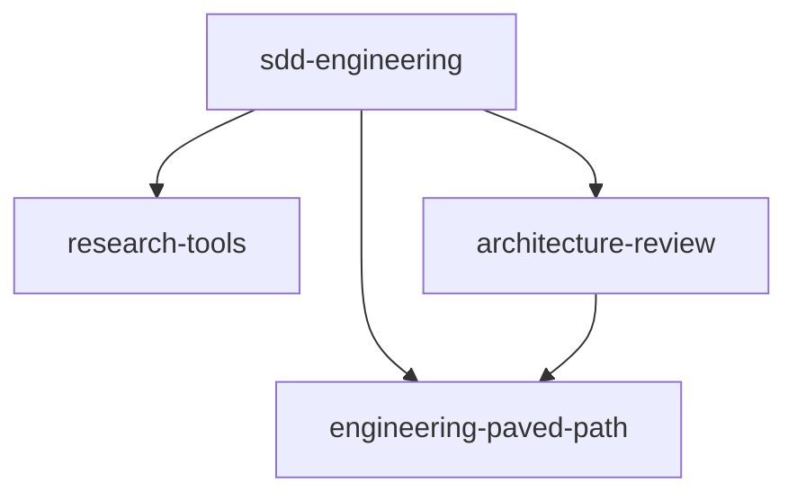

# Plugins specification (temporary)

Temporary working spec for the first release. Delete this directory after the plugins are created
and their READMEs carry this information.

Source: the `.claude/` directory of the source project (branch `module-l05`). Components are copied
as an initial extraction and then generalized: no product names, module paths or hard-coded
commands remain.

## Component inventory and grouping

| Group | Components | Decision |
|---|---|---|
| 1. Reusable | agents `spec-creator`, `implementation-planner`, `implementer`, `plan-verifier`, `test-writer`, `researcher`, `architecture-reviewer`; skills `run-plan`, `workflow-retro`, `engineering-insights` and the 12 engineering skills listed below | Move into plugins after generalization |
| 2. Project-specific | `CLAUDE.md`, `AGENTS.md`, `INSIGHTS.md`, `TESTING.md`; product specs and plans; skill `pr-self-review` (file routing, severity scale, scripts); the `gate.mjs` PreToolUse hook and the pre-push hook; agent `doc-writer`; the project-specific reference and evals of `react-architecture` | Stay in the source project. Plugins read repository-local docs instead |
| 3. Optional integrations | The project MCP server and the `mcp__<server>__*` tools of `spec-creator` | Not shipped in 1.0.0. `spec-creator` may use a conventions MCP server if the project provides one |
| 4. Local leftovers | Retro ledger data, session transcripts, `skills-lock.json`, upstream authoring files (`tile.json`, `AGENTS.md`, templates) | Not shipped. Upstream sources go to the attribution section of the `engineering-paved-path` README |

## Plugins

| Plugin | Agents | Skills | Depends on |
|---|---|---|---|
| `engineering-paved-path` | — | `react-best-practices`, `react-architecture`, `react-testing-library`, `next-best-practices`, `fastify-best-practices`, `onion-architecture`, `drizzle-orm-patterns`, `postgresql-table-design`, `zod`, `typescript-expert`, `security`, `mermaid-diagram` | — |
| `research-tools` | `researcher` | — | — |
| `architecture-review` | `architecture-reviewer` | — | `engineering-paved-path@^1.0.0` |
| `sdd-engineering` | `spec-creator`, `implementation-planner`, `implementer`, `plan-verifier`, `test-writer` | `run-plan`, `workflow-retro`, `engineering-insights` | `engineering-paved-path@^1.0.0`, `research-tools@^1.0.0`, `architecture-review@^1.0.0` |

Consumers of the engineering skills:

| Skill | Consumers |
|---|---|
| onion, fastify, drizzle, react-architecture, next, zod, typescript | `implementation-planner`, `implementer`, `test-writer`, `architecture-reviewer` (preloaded) |
| postgresql-table-design, react-best-practices | `implementation-planner`, `implementer` (preloaded) |
| react-testing-library | `implementation-planner`, `implementer`, `test-writer` (preloaded) |
| security | `implementer` (loaded with the Skill tool when a file needs it) |
| mermaid-diagram | diagrams in specs and plans |

## Dependency graph

```text
sdd-engineering@1.0.0
├── engineering-paved-path@^1.0.0
├── research-tools@^1.0.0
└── architecture-review@^1.0.0
    └── engineering-paved-path@^1.0.0
```



Edges go only from `sdd-engineering` to the three dependencies and from `architecture-review` to
`engineering-paved-path`. There are no cycles. Release order: `engineering-paved-path`,
`research-tools`, `architecture-review`, then `sdd-engineering`.

## Workflow

```text
idea ─► sdd-engineering:spec-creator ─► spec ─► [user approval]
      ─► sdd-engineering:implementation-planner ─► plan ─► [user approval]
      ─► /run-plan <plan>:
           implementer (per phase)
           ─► architecture-review:architecture-reviewer ─► fix loop (max 2)
           ─► test-writer (limited)
           ─► plan-verifier (final, read-only)
      ─► /workflow-retro (manual only)
research-tools:researcher answers questions at any step, on request.
```

## Generalization rules

- References across plugins are namespaced: `engineering-paved-path:onion-architecture`,
  `research-tools:researcher`, `architecture-review:architecture-reviewer`. Own components are
  referenced by full name where a field expects a plugin-scoped name (`sdd-engineering:implementer`).
- File-to-skill routing: pick skills from `engineering-paved-path` by file type. A routing document in
  the target repository, if present, takes precedence.
- The severity scale used by `architecture-reviewer` lives inside the agent.
- Default artifact locations: specs in `specs/`, plans in `docs/plans/`, retro ledger in
  `docs/retros/ledger.md`. The conventions in the target repository's `CLAUDE.md` override them.
- Verification commands come from the target repository (`CLAUDE.md`, `package.json`, CI). If none is
  found, the check is reported as SKIPPED or UNVERIFIABLE, never as PASS.
- `engineering-insights` writes to the nearest `INSIGHTS.md` (package or repository root) without a
  fixed list of modules.
- `onion-architecture` and `react-architecture` describe generic layouts; project-specific examples are removed.
- `run-plan` suggests follow-up steps only when they exist in the target project.
- Scripts inside skills are called through `${CLAUDE_SKILL_DIR}`.
- `spec-creator` drops project MCP tools from `tools`.
- All text is in English. A search for product names, product module paths and package-manager-specific
  commands returns nothing except generic context.

## Files per plugin

Every plugin has `.claude-plugin/plugin.json`, `README.md` (how to use it, capabilities, permissions,
network access), `CHANGELOG.md` and `COMPATIBILITY.md` (Claude Code >= 2.1.110).

`sdd-engineering/evals/evals.json` holds a minimal behavior and negative set:

1. `spec-creator` asks clarifying questions for a vague feature idea and writes a spec without
   implementation details, with an EARS acceptance criterion and AC-ID for each requirement.
2. `implementation-planner` builds a plan whose steps reference only AC-IDs from the given spec and
   returns "Clarification needed" when the spec has a gap.
3. An unrelated request (for example, explaining closures in JavaScript) does not start the SDD agents
   or `run-plan`.

Running the evals and the cost baseline are out of scope for this release.

## Attribution

Third-party skills keep their upstream source in the `engineering-paved-path` README:
`next-best-practices` (vercel-labs/next-skills), `fastify-best-practices` (mcollina/skills),
`drizzle-orm-patterns` (giuseppe-trisciuoglio/developer-kit), `postgresql-table-design`
(wshobson/agents), `typescript-expert` (sickn33/antigravity-awesome-skills), `zod`
(pproenca/dot-skills). Upstream licenses are checked before publishing.
